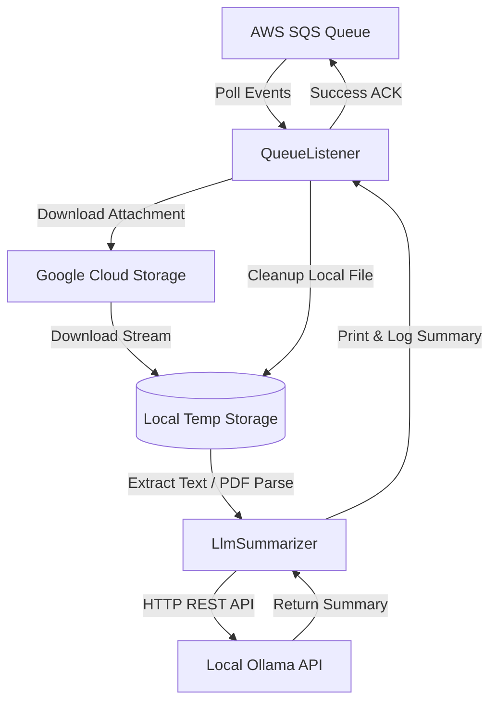

# Attachment Summarizer Service

An enterprise-ready Node.js & TypeScript microservice that consumes attachment event messages from an AWS SQS queue, downloads the referenced files from Google Cloud Storage (GCS), extracts their text contents (supporting PDFs, JSON, CSV, markdown, text, etc.), and processes them through a local Ollama LLM to generate high-quality natural language summaries.

---

## Architecture & Service Components



### 1. Queue Event Listener (`src/services/queueListener.ts`)
- Polls AWS SQS using high-efficiency **Long Polling** (`WaitTimeSeconds: 20`) to minimize API requests and network costs.
- Dynamically parses the event payload. In case SQS messages are corrupt, malformed, or missing required attributes, deletes them immediately as "poison-pills" to prevent processing queue deadlocks.
- Orchestrates the full downloading, parsing, and LLM summarization pipeline.
- Automatically handles acknowledging and deleting the SQS event from the queue on success.
- If processing fails, instantly resets the message visibility timeout (`VisibilityTimeout: 0`) in the queue so it can be retried immediately by another worker instance.
- **Strict Disk Management**: Employs a `finally` block to guarantee local files are deleted after each run, preventing filesystem exhaustion.

### 2. Storage Downloader (`src/services/storageDownloader.ts`)
- Imports the official Google Cloud Storage SDK (`@google-cloud/storage`) to stream GCS blobs down to safe local temp environments.
- Resolves key credentials dynamically, falling back to **Application Default Credentials (ADC)** or a dedicated file via `GOOGLE_APPLICATION_CREDENTIALS`.
- Integrates path safety utilities (`path.basename`) to actively block any **Directory Traversal** attacks from compromised bucket event notifications.
- Validates the existence of the cloud object before downloading, throwing early exceptions to eliminate unnecessary connection state leaks.

### 3. LLM Summarizer (`src/services/llmSummarizer.ts`)
- Extracts document text depending on file extensions (supporting `.pdf`, `.txt`, `.md`, `.json`, `.csv`, etc.).
- Implements full **PDF text parsing** out-of-the-box using the powerful `pdf-parse` library.
- Restricts input payload sizes to prevent context window limit overflows or high-memory exhaustion on the host, truncating gracefully when needed.
- Connects directly to the local **Ollama REST API** endpoint (`/api/generate`) with strict parameters, such as a lowered `temperature` coefficient (`0.3`) to prioritize factual analysis over creative hallucination.

### 4. Application Bootstrapper (`src/index.ts`)
- Loads configurations from environment files via `dotenv`.
- Binds listener streams to system signals (`SIGINT`, `SIGTERM`) to implement graceful shutdown cycles (essential for zero-downtime containerized deploys).
- Catches unhandled Promise rejections and uncaught exception handlers to prevent silent service failure and guarantee that crashes are logged.

### 5. Structured Logger (`src/utils/logger.ts`)
- Implements micro-level formatted console streams (`INFO`, `DEBUG`, `WARN`, `ERROR`).
- Safely extracts error descriptions, message targets, and complete call stack traces, preventing JSON serialization errors or losing context details.

---

## Configuration Settings

Copy the configuration template and customize the values:
```bash
cp .env.example .env
```

| Key | Description | Default |
|-----|-------------|---------|
| `AWS_REGION` | Target AWS datacenter region | `us-east-1` |
| `SQS_QUEUE_URL` | SQS endpoint queue url (required) | *None* |
| `AWS_ACCESS_KEY_ID` | Local AWS access key (fallback) | *None* |
| `AWS_SECRET_ACCESS_KEY` | Local AWS secret key (fallback) | *None* |
| `GOOGLE_APPLICATION_CREDENTIALS` | Path to your GCP JSON credential file | *None* |
| `GOOGLE_CLOUD_PROJECT` | Active Google Cloud Project ID | *None* |
| `OLLAMA_HOST` | Local or remote Ollama server host URL | `http://localhost:11434` |
| `OLLAMA_MODEL` | Target language model loaded in Ollama | `llama3` |
| `LOG_LEVEL` | Diagnostic log granularity (`DEBUG`, `INFO`, `WARN`, `ERROR`) | `INFO` |

---

## Local Development & Setup

### Prerequisites
- Node.js (v20 or higher)
- A running instance of **Ollama** with your model loaded locally:
  ```bash
  ollama run llama3
  ```

### Steps to Run
1. Install project dependencies:
   ```bash
   npm install
   ```
2. Start the application in development mode with `ts-node`:
   ```bash
   npm run dev
   ```
3. Build and execute production compiled files:
   ```bash
   npm run build
   npm start
   ```

---

## Production Deployment with Docker

The microservice includes a fully audited, highly optimized multi-stage `Dockerfile` to create minimum-size production containers with host security best practices.

### Building the Image
```bash
docker build -t attachment-summarizer .
```

### Running the Container
Ensure the container can reach your local host Ollama service. If Ollama is running on your physical machine, use `host.docker.internal` (Windows/Mac) or your local network IP:
```bash
docker run -d --name attachment-summarizer \
  -e SQS_QUEUE_URL="https://sqs.us-east-1.amazonaws.com/123456789012/attachment-queue" \
  -e AWS_REGION="us-east-1" \
  -e GOOGLE_APPLICATION_CREDENTIALS="/app/gcs-key.json" \
  -v /path/to/local/gcs-service-account.json:/app/gcs-key.json:ro \
  -e OLLAMA_HOST="http://host.docker.internal:11434" \
  -e OLLAMA_MODEL="llama3" \
  attachment-summarizer
```
